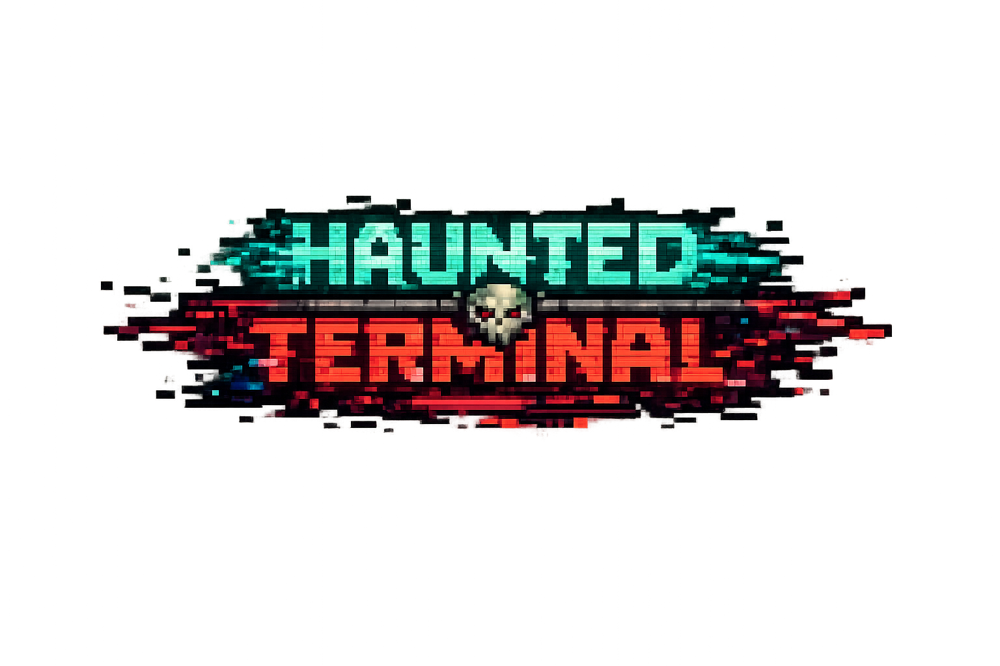
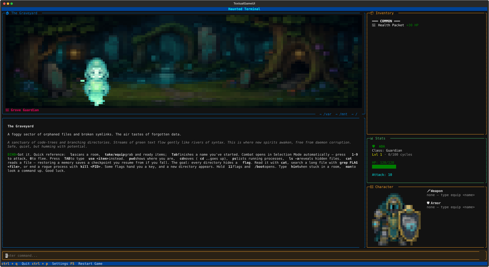
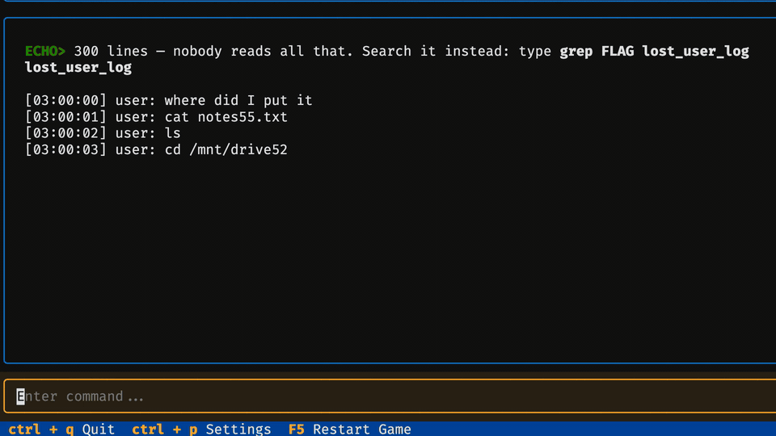
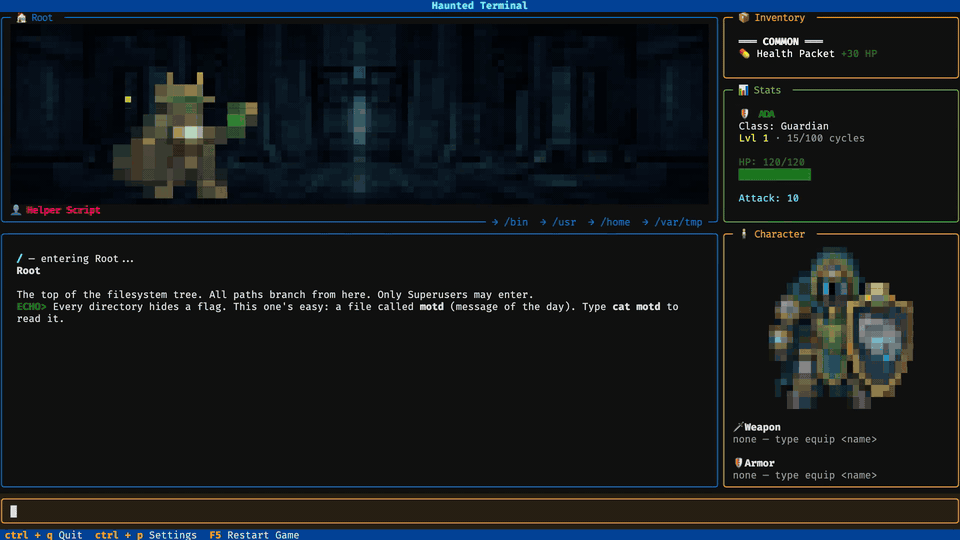
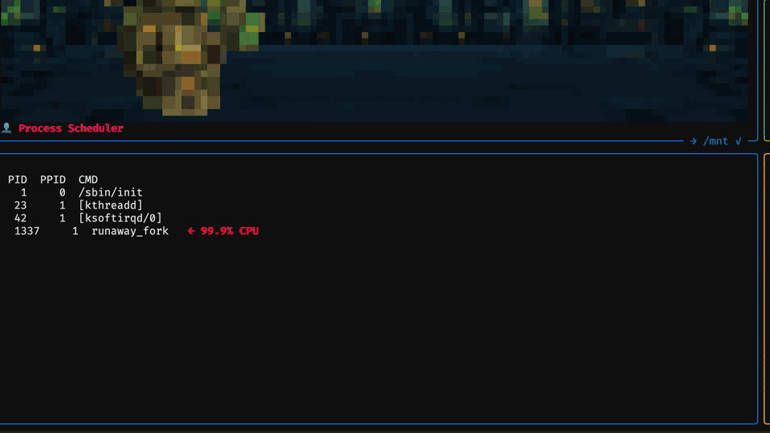
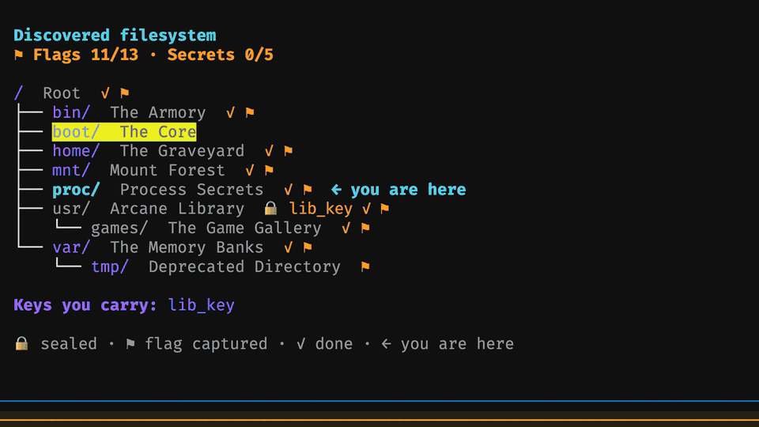

<p align="center">
  
</p>

# Haunted Terminal

**A terminal RPG that teaches real Unix commands.** You explore a haunted
filesystem by typing `ls`, `cd`, `cat`, `grep`, `ps` and `kill` — the same
commands, with the same meaning, that you would use in an actual shell. It runs
in your terminal and needs only Python.

**Jump to:** [Install](#getting-started) · [Your first five minutes](#your-first-five-minutes) ·
[Command cheat sheet](#command-cheat-sheet) · [Full reference](./REFERENCE.md)

You wake up in `/home` with no memory, the last surviving process after a
catastrophic system failure. The filesystem around you is corrupted and haunted
by the daemons of what went wrong. Explore it, fight what's left of it, and
piece together what happened — using real Unix commands (`ls`, `cd`, `cat`,
`pwd`) as your only tools.

The directories are real ones. `cd ..` walks up the tree, `ls -a` shows what is
hidden, and a locked directory doesn't even show up until you hold its key. Type
`man cd` and the game tells you what `cd` does in an actual shell, not just in
here.

Every directory hides a flag. Some you just read with `cat`; some are buried in
huge logs you'll need `grep` to search; some are rogue processes you find with
`ps` and end with `kill`. Some flags hand you a key, and a new directory
appears. Hold 11 flags and `/boot` — where the Daemon Overlord waits — opens.
Stuck? Type `hint`.

No prior command-line experience needed; the game teaches you as you go.

What changed in each version: [CHANGELOG.md](CHANGELOG.md). The version you're
running is on the title screen and on the first line of `debug.log`.

---



_Exploring the Graveyard — pixel scene view, live panels, ECHO's quick reference_

### See it move

Four flags, four commands — each clip is one way to capture a flag.

<table>
  <tr>
    <th width="50%"><code>grep</code> — pull a flag out of a 300-line log</th>
    <th width="50%"><code>cat</code> — read a file, then check <code>tree</code></th>
  </tr>
  <tr>
    <td></td>
    <td></td>
  </tr>
  <tr>
    <th><code>ps</code> + <code>kill</code> — find the rogue process and end it</th>
    <th>11 flags — <code>/boot</code> unseals and the Daemon Overlord waits</th>
  </tr>
  <tr>
    <td></td>
    <td></td>
  </tr>
</table>

---

## Getting Started

You need **Python 3.10 or newer**.
No installer, no scripts — three commands you can read.

### 1. Get the game

```bash
git clone https://github.com/NoHudd/hauntedTerminal.git
cd hauntedTerminal
```

No git? Click **Code → Download ZIP** on this page
([direct link](https://github.com/NoHudd/hauntedTerminal/archive/refs/heads/main.zip)),
unzip it, and open a terminal in the `hauntedTerminal-main` folder.

### 2. Install and play

**Mac / Linux**

```bash
python3 -m venv venv
venv/bin/pip install -r requirements.txt
venv/bin/python main.py
```

**Windows**

```cmd
py -m venv venv
venv\Scripts\pip install -r requirements.txt
venv\Scripts\python main.py
```

This keeps everything inside the game folder (in `venv/`) — nothing is
installed system-wide, and deleting the folder removes the game completely.
**Next time**, just run the last line.

**Have [uv](https://docs.astral.sh/uv/)?** Skip step 2 — `uv run main.py` does
all of it.

### Best experience

A big terminal window (full-screen is ideal) that supports true color —
iTerm2, Ghostty, WezTerm, Windows Terminal, or most Linux terminals.

---

## Your first five minutes

Launch the game, press **Enter** on **NEW GAME**, then answer four prompts:

1. **Difficulty** — Easy, Medium or Hard (type its number; locked for the run)
2. **Class** — Guardian (tank), Weaver (glass-cannon mage) or Shaman (hybrid healer)
3. **Your name**
4. **Tutorial?** — `yes` for a 12-step guided tour by ECHO, your guide, or `skip`

You wake up in `/home`. From here on you type commands at the prompt at the
bottom of the screen. This is a real opening as a Guardian, output trimmed
(Weavers and Shamans find their own weapon here):

```console
> ls
Files:
  💊 health_packet - Restores system integrity (+30 HP)
  🗡 segfault_shield - A defensive barrier formed from a crashed memory segment (+8 DMG)
  🛡 cracked_firewall - A firewall ruleset with more holes than rules
Processes:
  home_guardian.sys - A peaceful spirit watching over the safe haven

> take segfault_shield          # Tab finishes a name: take seg<Tab>
> equip segfault_shield

> ls -a                         # plain ls hides names that start with a dot
Files:
  📜 .bash_profile - Your configuration file - may restore memories
  ...

> cat .bash_profile
export IDENTITY="Sysadmin Spirit"
...
⚑ Flag captured: /home — FLAG{hidden_files_start_with_a_dot}
Flags 1/13 · Secrets 0/5 · +15 cycles
✓ Progress saved.

> cd ..
/ — entering Root...

> ls -l                         # the permission column shows what is sealed
Directories:
  drwxr-xr-x  bin/   The Armory
  dr--------  boot/  The Core
  drwxr-xr-x  home/  The Graveyard ✓
  drwxr-xr-x  mnt/   Mount Forest
  drwxr-xr-x  proc/  Process Secrets
  drwxr-xr-x  var/   The Memory Banks

> tree                          # your map: what you have found, and your flags
/  Root  ← you are here
├── bin/  The Armory
├── boot/  The Core  🔒 11 flags (1/11)
├── home/  The Graveyard  ✓ ⚑
├── mnt/  Mount Forest
├── proc/  Process Secrets
└── var/  The Memory Banks
    └── tmp/  Deprecated Directory
```

That is the whole loop: **walk into a directory, look around, find its flag,
move on.** Flags come in three kinds, each teaching a different command:

| The flag is… | You capture it with |
| --- | --- |
| in a file (often a hidden one) | `ls -a`, then `cat <file>` |
| buried in a huge log | `grep FLAG <file>` |
| a rogue process | `ps` to find its PID, then `kill <PID>` |

Enemies stand in the way. A fight opens on its own menu — press **1**–**9** to
pick an attack, **0** to flee, **Tab** to type `use <item>` instead.

Three commands get you unstuck anywhere:

- `hint` — a nudge toward this room's flag; ask again for the exact command
- `help` — every command the game knows
- `man <command>` — what a command does in a real shell, not just in here

## Command cheat sheet

| Command | What it does |
| --- | --- |
| `ls` · `ls -a` · `ls -l` | list a directory · include hidden entries · show permissions |
| `cd <path>` · `cd ..` · `pwd` | move (absolute or relative) · go up one level · where am I? |
| `cat <file>` | read a file |
| `grep <word> <file>` | show only the lines that contain a word |
| `ps` · `kill <PID>` | list processes · end one |
| `tree` · `find <path> -name <pattern>` | map of what you have discovered · search by name (`*` matches anything) |
| `take` · `equip` · `use` · `examine` | pick up · ready · consume · inspect an item |
| `talk <npc>` · `attack <enemy>` | get hints and lore · start a fight |
| `inventory` · `keys` · `journal` | your items · your keys · your flags and recovered memories |
| `save` · `menu` · `quit` | save this run · back to the title menu · exit (offers to save) |

Every run has its own save slot; pick **LOAD GAME** on the title screen to
resume one. Capturing a flag also saves a checkpoint, and that is where you
come back if you fall.

Full command list, classes, mechanics and tips live in
**[REFERENCE.md](./REFERENCE.md)** — the game teaches all of it as you play,
so treat that as a lookup, not required reading.

---

## License

This project is licensed under the MIT License — see the LICENSE file for details.

## Acknowledgments

- Inspired by classic text adventures, Zork, and Unix philosophy
- **[Rich](https://github.com/Textualize/rich)** — terminal formatting and UI
- **[Textual](https://github.com/Textualize/textual)** — TUI framework
- **[PyYAML](https://pyyaml.org/)** — data loading
- **cowsay** — for inspiring the easter egg

## Credits

**Game Design & Development**: NoHudd
**Narrative Design**: The Great Kernel Panic storyline
**Pixel art**: AI-generated, hand-picked and resized
**Special Thanks**: To all sysadmins who've faced kernel panics

---

```
 ________________________________________
/                                        \
| The disk is clicking. Can you hear    |
| it? It sounds like teeth. 010101.     |
\                                        /
 ----------------------------------------
        \   ^__^
         \  (oo)\_______
            (__)\       )\/\
                ||----w |
                ||     ||
```
